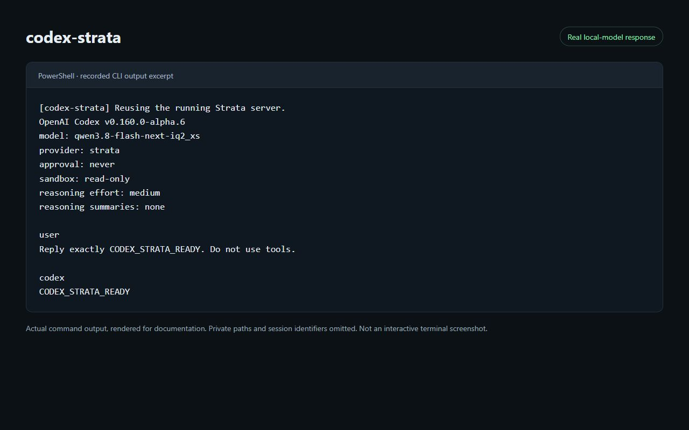
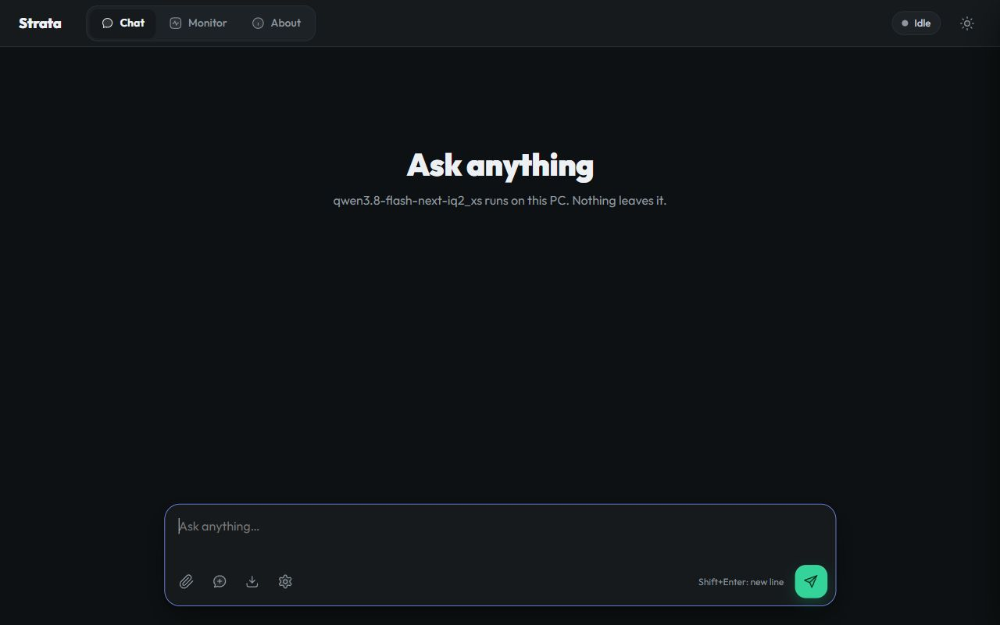

# codex-strata

A small Windows launcher for running Codex CLI with a local Strata model.

[日本語](README.ja.md)



Rendered excerpt of an actual Codex CLI run through this launcher. Private
paths and session identifiers are omitted. This is a recording of command
output, not a screenshot of an interactive terminal window.

```powershell
codex-strata
```

The launcher checks Strata, starts it in the background if needed, waits for a
healthy response, then opens Codex in your current directory. A running server
is reused. Concurrent launches start only one server. An unrelated service or a
different Strata model on the configured port causes an error rather than being
replaced.

This is an independent, unofficial project. It does not include Codex, Strata,
model weights, accounts, or API credentials.

## Requirements

- Windows and PowerShell 7.3 or newer (`pwsh` available on PATH).
- [Codex CLI](https://github.com/openai/codex) installed separately, with `codex`
  available on PATH or its native executable configured explicitly. The usual
  npm `codex.cmd` is detected and its Node entry point is invoked directly.
- [Strata](https://github.com/Niko1221/Strata) already installed, including its
  Python virtual environment and an engine configuration produced by setup.
- Hardware and model files that meet Strata's own requirements.

The launcher was verified with PowerShell 7.6.6 and Codex CLI
0.160.0-alpha.6. Codex's custom model metadata format may change; other versions
are not yet verified. Python 3.10+ is needed only for the integration tests; the
launcher uses Strata's installed interpreter.

## Install

Download or clone this project. From its folder, run in PowerShell 7:

```powershell
.\install.ps1 -StrataRoot "$HOME\dev\Strata" -AddToPath
```

The default install folder is `%LOCALAPPDATA%\Programs\codex-strata`. The
installer copies the launcher and license, creates your local `settings.json`,
and adds that folder to your **user** PATH only when `-AddToPath` is supplied.
Reopen your terminal, then:

```powershell
Get-Command codex-strata -All
codex-strata
```

For another model configuration:

```powershell
.\install.ps1 -StrataRoot 'D:\Strata' -EngineConfig 'strata-coder-iq1_m.json' -AddToPath
```

An existing `codex-strata` earlier on PATH can take priority, particularly a
launcher inside an nvm-managed Node installation. The installer reports the
conflict and does not replace that command. Use the new launcher's full path or
resolve the older PATH entry yourself.

To update an installation, use the same command with `-Force`. Existing
`settings.json` is preserved; replaced launcher files are backed up under the
installation's `backups` directory. Edit the preserved settings if your Strata
location changes. No model download or dependency installation is performed.

If script execution is blocked, follow your machine's PowerShell execution
policy. The launcher does not change or bypass that policy.

## Portable use

Copy `settings.example.json` to `settings.json`, set `strata_root`, then run:

```powershell
.\codex-strata.cmd
.\codex-strata.cmd exec --skip-git-repo-check 'Summarize this directory without editing files.'
```

Codex arguments are forwarded, and its exit code is preserved. For complex
quoted prompts or structured `-c` values, invoke the PowerShell script directly:

```powershell
& .\codex-strata.ps1 exec 'Explain the function named "parse_input".'
```

Use the `.ps1` entry point for literal `%`, `&`, `|`, and other shell-sensitive
characters. Your calling shell can interpret these before a `.cmd` shim runs.
Custom batch launchers for Codex are rejected; use a native executable, or
`node.exe` with `codex_args_prefix` pointing to Codex's JavaScript entry point.

Global `--help`, `-h`, `--version`, and `-V` skip server startup. Other commands,
including `exec --help`, run the server check first.

## Settings

The launcher reads `settings.json` beside the script. Set
`CODEX_STRATA_CONFIG` to use another settings file. Windows environment variables
such as `%USERPROFILE%` are expanded in paths. `~` and `$HOME` inside JSON are
not expanded.

| Setting | Default / meaning |
| --- | --- |
| `strata_root` | Required Strata installation directory; relative to the settings file |
| `engine_config` | `strata-iq2_xs.json`; relative to `strata_root`, or absolute |
| `model` | Empty: use the engine config's `model_name`; otherwise request this model alias |
| `port` | Null: use the engine config's port, or 8080 |
| `context_window` | Null: read `--max-context` from engine args, or use 32768 |
| `reasoning_effort` | `medium`; also accepts `none`, `low`, `high` |
| `startup_timeout_seconds` | 180; range 1–600; waits for the HTTP API |
| `stream_idle_timeout_ms` | 600000; allows time for model loading / long responses |
| `codex_command` | `codex`; native executable, or the official npm `codex.cmd` shim |
| `codex_args_prefix` | `[]`; optional string arguments placed before Codex options, such as a `codex.js` path when `codex_command` is `node.exe` |
| `python_path` | `.venv\Scripts\python.exe`; relative to `strata_root`, or absolute |
| `codex_home` | Empty: `%LOCALAPPDATA%\codex-strata\codex-home` |
| `logs_dir` | Empty: `%LOCALAPPDATA%\codex-strata\logs` |
| `api_key_env` | Empty: no provider credentials; otherwise an environment variable name |

The launcher checks the server's identity against the engine config's
`model_name`, even when `model` is a different request alias. It always starts
the server on `127.0.0.1`.



Strata's actual web interface after connecting to the local server. The empty
chat avoids including any conversation history in the screenshot.

Codex uses an isolated `CODEX_HOME`. Your usual Codex configuration and
authentication files are not copied or edited. The launcher passes the local
provider settings through Codex's command-line overrides and creates its own
`codex-strata-models.json` in the isolated home. Setting `codex_home` to an
existing home deliberately opts into loading its configuration; prefer a
dedicated directory.

### Authenticated Strata servers

When your Strata configuration requires an API key, set `api_key_env` to an
environment variable containing the same key. Store the **variable name**, not
the secret, in settings. For example, use `STRATA_API_KEY`, which Strata also
accepts from its environment when starting. The launcher never prints the key
or writes it to its model catalog. It does not check whether a supplied key is
correct; the server will report an authentication error if it is not.

## Startup and troubleshooting

`loaded: false` is normal when Strata's `lazy_load` setting is enabled. The HTTP
API can be ready before the model is loaded; the first generation request loads
the model. Strata's idle-unload setting can release the model while leaving the
server running. The launcher preserves those settings.

| Symptom | Next step |
| --- | --- |
| Settings missing | Run the installer, or create `settings.json` from the example |
| Codex not found | Check `Get-Command codex -All`; set `codex_command` if necessary |
| Custom batch launcher rejected | Set a native executable, or `node.exe` plus `codex_args_prefix` containing the `codex.js` path |
| Port occupied / wrong service | Inspect the process using that port, or choose another port |
| Wrong model | Match `engine_config` to the running server, or stop it yourself before switching |
| Startup exited | Read the stdout/stderr log paths shown by the launcher |
| Startup timeout | The starting server is left running; inspect logs and retry after it becomes ready |
| Slow first response | Wait for Strata to load the model; check available RAM/VRAM and Strata's engine log |
| API key required | Set `api_key_env` and supply the matching environment variable |

Each new startup gets separate stdout/stderr files. Logs are not automatically
deleted. The server continues running after Codex exits. To stop it, stop your
Strata server through its normal process-management method. This project does
not automatically terminate an existing server.

## Verify changes

No third-party testing packages are required:

```powershell
python -B tests/test_launcher.py
```

Tests use temporary mock servers and a fake Codex command. They exercise
startup, reuse, concurrent launch, paths with spaces, argument forwarding,
authentication handling, errors, timeout, and exit codes without loading a
model or touching a real Strata server. Run with your project's Python
environment, if you have one.

Local inference does not make the whole Codex CLI offline: Codex's own
plugin/update routines may still contact upstream services.

The release review and verification record is in [docs/REVIEW.md](docs/REVIEW.md).

## License and upstream projects

This launcher's original code is licensed under [Apache-2.0](LICENSE), copyright 2026 aktsmm.
See [NOTICE](NOTICE) for attribution.
Third-party projects retain their own licenses:

- [Strata: MIT](https://github.com/Niko1221/Strata/blob/main/LICENSE).
- [Codex CLI: Apache-2.0](https://github.com/openai/codex/blob/main/LICENSE).
- Model weights and Strata's dependencies have their own applicable terms.

The launcher is distributed separately and does not relicense those projects.
The documented Strata screenshot is attributed in [NOTICE](NOTICE), with its
upstream license preserved in [docs/licenses/Strata-MIT.txt](docs/licenses/Strata-MIT.txt).
